

  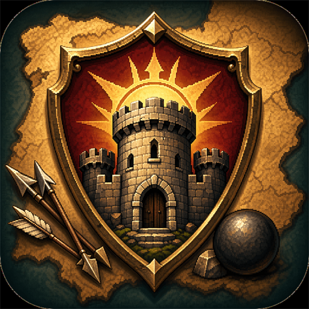

# Reconquista TD

**Defiende ciudades, domina el terreno y recorre la península.**

Un juego de defensa de torres ambientado en la península medieval, pensado para
pantallas táctiles y también disponible en Windows. Decide dónde construir,
combina armas de asedio y dirige a tu héroe frente a oleadas cada vez más exigentes.

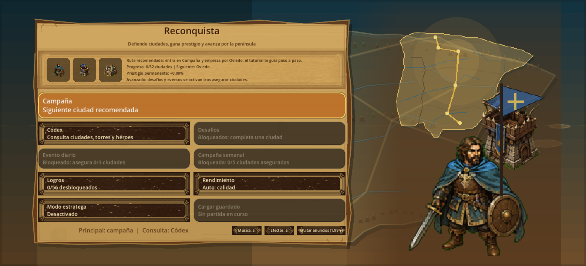

## Descarga gratuita

> **El código del juego es privado.** GitHub añade automáticamente enlaces
> llamados «Source code (zip)» y «Source code (tar.gz)» a las releases. Esos
> archivos contienen únicamente la documentación e imágenes de este repositorio
> público, no el proyecto ni los scripts del juego. Para jugar, descarga el APK
> de Android o el ZIP de Windows indicados a continuación.

Primera beta pública: **0.1.0-beta.1**. El juego sigue en desarrollo.

| Plataforma | Descarga | Instalación |
| --- | --- | --- |
| Android 7.0 o posterior, ARM64 | [Descargar APK](https://github.com/javieratomic/reconquista/releases/download/v0.1.0-beta.1/reconquista-0.1.0-beta.1-android-arm64.apk) | Instala el APK en tu teléfono. |
| Windows 10/11 de 64 bits | [Descargar ZIP portable](https://github.com/javieratomic/reconquista/releases/download/v0.1.0-beta.1/reconquista-0.1.0-beta.1-windows-x64.zip) | Extrae la carpeta completa y ejecuta `Reconquista.exe`. |

[Todas las versiones y notas de publicación](https://github.com/javieratomic/reconquista/releases)
· [Comprobaciones SHA-256](https://github.com/javieratomic/reconquista/releases/download/v0.1.0-beta.1/SHA256SUMS.txt)

## Qué encontrarás

- **52 ciudades y cinco eras** en una campaña con progresión, estrellas y prestigio.
- **Siete tipos de torre**, con mejoras y ramas para especializar tu defensa.
- **Cinco héroes históricos**: Don Pelayo, El Cid, Alfonso VI, Jaime I e Isabel la Católica.
- Enemigos con armadura, escudos, curación e invisibilidad, además de jefes en ciudades clave.
- **Supervivencia endless**, con récords y mejoras permanentes exclusivas de ese modo.
- **31 eventos diarios** que rotan según el día del mes y una campaña semanal destacada.
- Desafíos de ciudad, decretos, sellos de maestría, logros y códex de consulta.
- Velocidades **x1, x1.5, x2 y x3**, pausa y guardado local de la partida.

### Una campaña por la península

Desbloquea ciudades siguiendo la campaña y consulta sus rutas, retos y contexto.
Los modos diarios y las repeticiones especiales mantienen separada la progresión
normal de campaña.

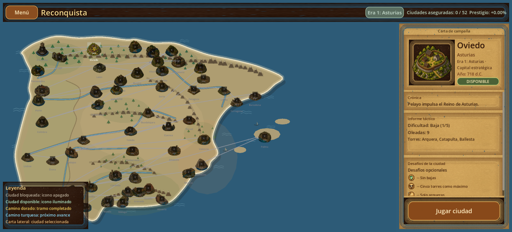

### Construye con intención

El terreno, los cruces y las entradas importan. Las catapultas y los trabuquetes
buscan grupos; las ballestas priorizan enemigos poderosos. Consulta la información
enemiga y combina tus defensas para afrontar cada nivel.

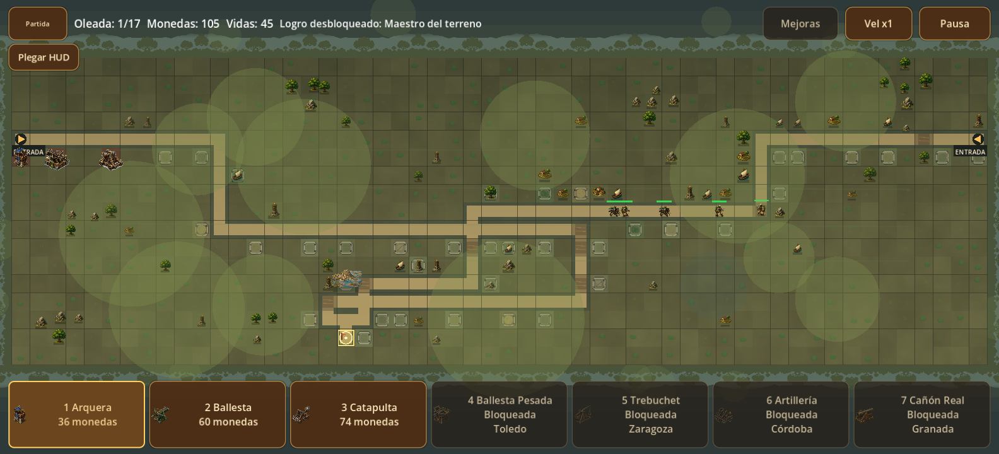

Vista ampliada de **Santander**, con su enclave costero, bosques, edificios de
apoyo y defensas en combate.

### Consulta el códex

Revisa ciudades, torres, enemigos, héroes y terrenos para conocer sus características.

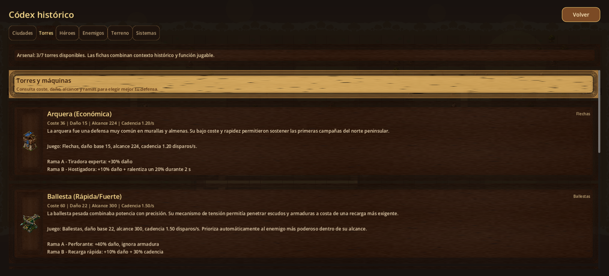

Las imágenes son capturas del juego en ejecución. El aspecto y la distribución
de la interfaz se adaptan al tamaño de pantalla.

<!-- BEGIN ART GALLERY -->
## El arte, de cerca

Sprites originales del juego ampliados para apreciar sus armas, armaduras y siluetas. Pulsa sobre una imagen para abrirla por separado. Estas láminas muestran el arte estático; las unidades se animan durante la partida.

### Héroes históricos

<table>
  <tr>
    <td align="center"><a href="media/art/hero_pelayo.png">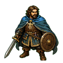</a> <strong>Don Pelayo</strong></td>
    <td align="center"><a href="media/art/hero_cid.png">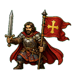</a> <strong>El Cid</strong></td>
    <td align="center"><a href="media/art/hero_alfonso.png">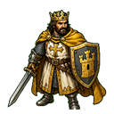</a> <strong>Alfonso VI</strong></td>
  </tr>
  <tr>
    <td align="center"><a href="media/art/hero_jaime.png">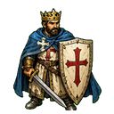</a> <strong>Jaime I</strong></td>
    <td align="center"><a href="media/art/hero_isabel.png">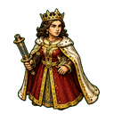</a> <strong>Isabel la Cat&#243;lica</strong></td>
  </tr>
</table>

### Enemigos y jefes

<table>
  <tr>
    <td align="center"><a href="media/art/enemy_normal.png">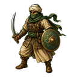</a> <strong>Infante</strong></td>
    <td align="center"><a href="media/art/enemy_fast.png">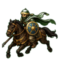</a> <strong>Jinete</strong></td>
    <td align="center"><a href="media/art/enemy_tank.png">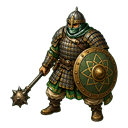</a> <strong>Blindado</strong></td>
    <td align="center"><a href="media/art/enemy_berber.png">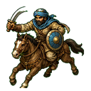</a> <strong>Jinete bereber</strong></td>
  </tr>
  <tr>
    <td align="center"><a href="media/art/enemy_shield.png">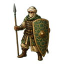</a> <strong>Escudo de torre</strong></td>
    <td align="center"><a href="media/art/enemy_healer.png">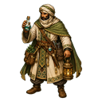</a> <strong>Ingeniero</strong></td>
    <td align="center"><a href="media/art/enemy_elephant.png">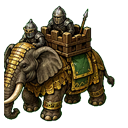</a> <strong>Elefante</strong></td>
    <td align="center"><a href="media/art/enemy_assassin.png">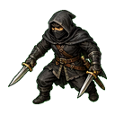</a> <strong>Asesino nazar&#237;</strong></td>
  </tr>
  <tr>
    <td align="center"><a href="media/art/boss_toledo.png">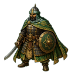</a> <strong>Se&#241;or de Toledo</strong></td>
    <td align="center"><a href="media/art/boss_zaragoza.png">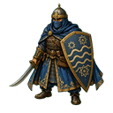</a> <strong>Guardi&#225;n del Ebro</strong></td>
    <td align="center"><a href="media/art/boss_cordoba.png">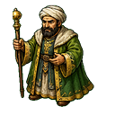</a> <strong>Wali de C&#243;rdoba</strong></td>
    <td align="center"><a href="media/art/boss_granada.png">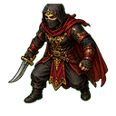</a> <strong>Emir de Granada</strong></td>
  </tr>
</table>

### Torres y máquinas de asedio

<table>
  <tr>
    <td align="center"><a href="media/art/tower_archer.png">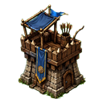</a> <strong>Arquera</strong></td>
    <td align="center"><a href="media/art/tower_heavy.png">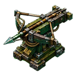</a> <strong>Ballesta</strong></td>
    <td align="center"><a href="media/art/tower_cannon.png">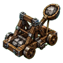</a> <strong>Catapulta</strong></td>
    <td align="center"><a href="media/art/tower_crossbow_heavy.png">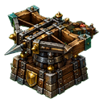</a> <strong>Ballesta Pesada</strong></td>
  </tr>
  <tr>
    <td align="center"><a href="media/art/tower_trebuchet.png">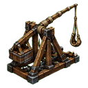</a> <strong>Trabuquete</strong></td>
    <td align="center"><a href="media/art/tower_gunpowder.png">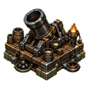</a> <strong>Artiller&#237;a de P&#243;lvora</strong></td>
    <td align="center"><a href="media/art/tower_royal_cannon.png">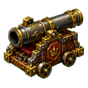</a> <strong>Ca&#241;&#243;n Real</strong></td>
  </tr>
</table>

### Arquitectura de seis ciudades

Interpretaciones artísticas de los enclaves del juego, con el periodo correspondiente a cada ciudad en la campaña.

<table>
  <tr>
    <td align="center"><a href="media/art/landmark_oviedo.png">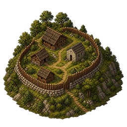</a> <strong>Oviedo</strong> Proto-Oviedo asturiano &#183; Asturias altomedieval, reconstrucci&#243;n c. 718</td>
    <td align="center"><a href="media/art/landmark_toledo.png">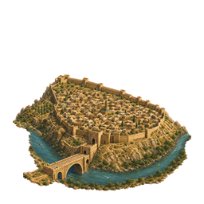</a> <strong>Toledo</strong> Medina de Tulaytula &#183; Taifa de Toledo, 1085</td>
    <td align="center"><a href="media/art/landmark_cordoba.png">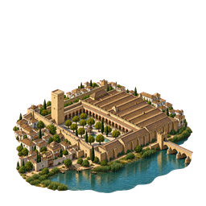</a> <strong>C&#243;rdoba</strong> Mezquita aljama de C&#243;rdoba &#183; Entrega de C&#243;rdoba, 1236</td>
  </tr>
  <tr>
    <td align="center"><a href="media/art/landmark_granada.png">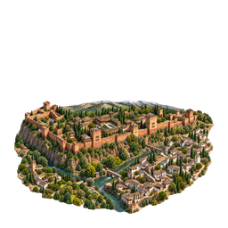</a> <strong>Granada</strong> Alhambra nazar&#237; &#183; Reino nazar&#237;, 1492</td>
    <td align="center"><a href="media/art/landmark_salamanca.png">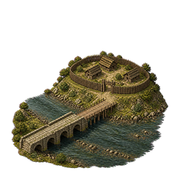</a> <strong>Salamanca</strong> Paso romano del Tormes &#183; Reocupaci&#243;n altomedieval, c. 1000</td>
    <td align="center"><a href="media/art/landmark_palma.png">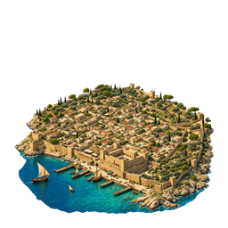</a> <strong>Palma</strong> Madina Mayurqa &#183; Fase almohade, 1229</td>
  </tr>
</table>

### Vida y paisaje de los biomas

Vegetación, construcciones rurales y detalles que acompañan a las rutas y dan personalidad a los escenarios.

<table>
  <tr>
    <td align="center"><a href="media/art/decor_pine.png">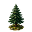</a> <strong>Pinar</strong></td>
    <td align="center"><a href="media/art/decor_olive.png">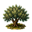</a> <strong>Olivos</strong></td>
    <td align="center"><a href="media/art/decor_palm.png">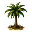</a> <strong>Palmera</strong></td>
    <td align="center"><a href="media/art/decor_vineyard.png">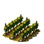</a> <strong>Vi&#241;edo</strong></td>
  </tr>
  <tr>
    <td align="center"><a href="media/art/decor_windmill.png">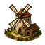</a> <strong>Molino</strong></td>
    <td align="center"><a href="media/art/decor_farmstead.png">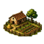</a> <strong>Caser&#237;o</strong></td>
    <td align="center"><a href="media/art/decor_boat.png">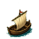</a> <strong>Barco</strong></td>
    <td align="center"><a href="media/art/decor_watchtower.png">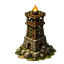</a> <strong>Atalaya</strong></td>
  </tr>
</table>

<!-- END ART GALLERY -->

## Cómo empezar

Entra en **Campaña** y comienza en **Oviedo**. El tutorial explica la colocación,
las mejoras y las herramientas de consulta. Los modos adicionales se desbloquean
al avanzar; no hace falta empezar por los desafíos diarios.

En Android, juega en horizontal. Toca una torre y confirma su ubicación; arrastra
para desplazar el mapa y utiliza dos dedos para ampliar o reducir la vista.
En Windows puedes utilizar ratón y teclado; la interfaz también incluye soporte
de mando. Las teclas `1`, `2` y `3` seleccionan las torres iniciales.

## Instalación y partidas

**Android:** esta descarga se instala desde GitHub, fuera de Google Play. Android
puede pedir permiso para instalar aplicaciones desde el navegador o gestor de
archivos que utilices. El APK está firmado con la clave de publicación del autor.

Las antiguas compilaciones de prueba usan otra firma y no admiten actualización
directa con este APK. **Si ya tienes una partida en una build de pruebas, no la
desinstales:** contacta con el autor antes para conservarla.

**Windows:** extrae todo el ZIP antes de ejecutar el juego. Esta beta no dispone de
firma Authenticode de Windows, por lo que el sistema puede mostrar un aviso.
Comprueba la procedencia y el hash del archivo. No necesitas instalar Godot ni Steam.

Las partidas se guardan localmente; esta versión no ofrece sincronización en la
nube. Las integraciones reales con Google Play, anuncios y compras siguen pendientes.

## Uso y permisos

**Puedes descargar, instalar y jugar gratis.** Para modificar el juego, crear
versiones derivadas, reutilizar sus elementos propios o monetizarlo necesitas
**permiso previo y por escrito** de su autor.

El código fuente se mantiene privado. Este repositorio contiene únicamente la
presentación, las condiciones y las descargas públicas; no es un proyecto de
código abierto.

[Condiciones completas](LICENSE.txt) · [Avisos de terceros](THIRD_PARTY_NOTICES.md)

Para solicitar permisos: **[javieratomic@gmail.com](mailto:javieratomic@gmail.com)**.
Describe qué deseas modificar o cómo deseas monetizarlo.

## Errores y sugerencias

Puedes [abrir una incidencia](https://github.com/javieratomic/reconquista/issues)
indicando ciudad, oleada, versión, dispositivo y los pasos que provocaron el problema.
Evita incluir datos personales en los informes públicos.

Desarrollado por **javieratomic** con Godot Engine.
